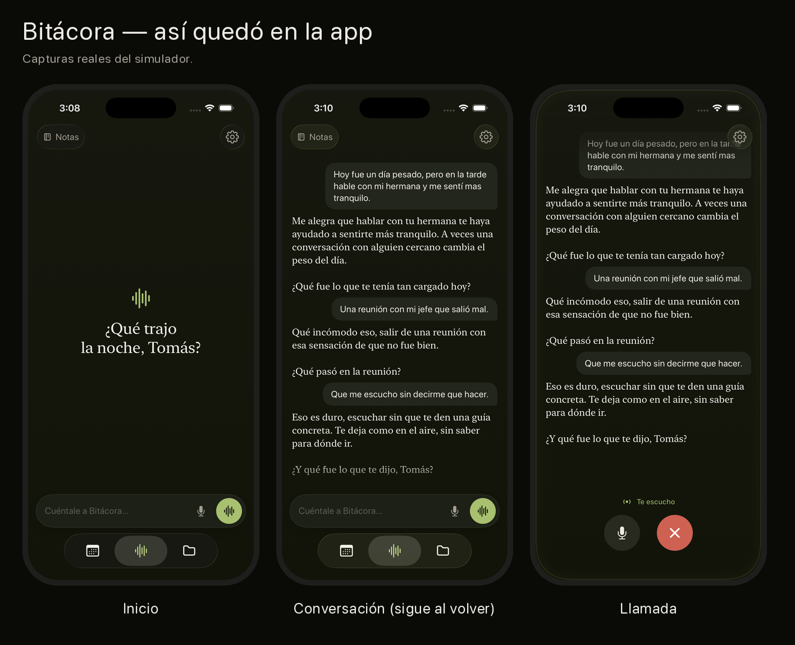
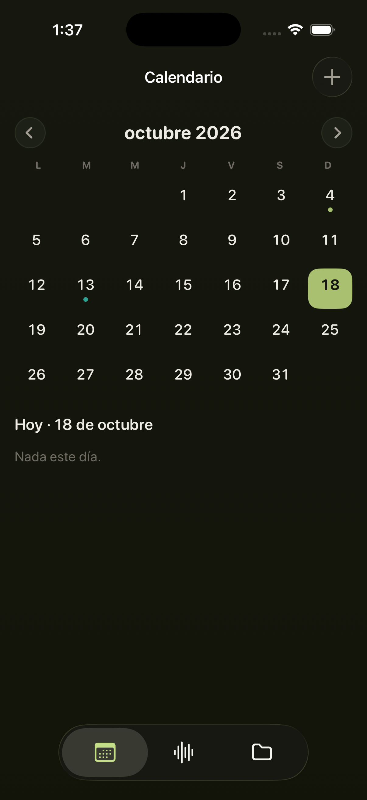
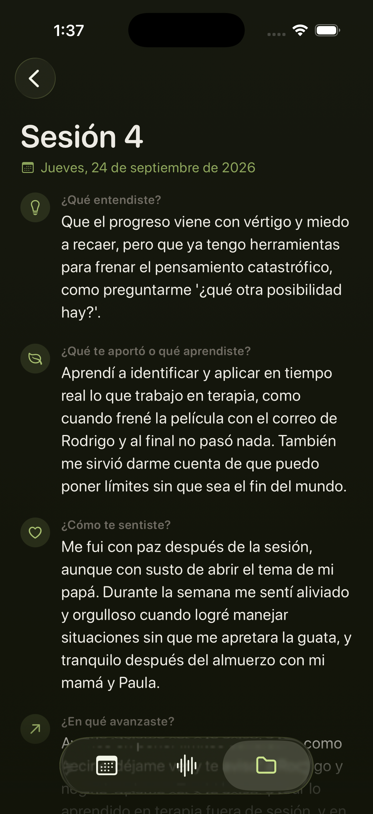
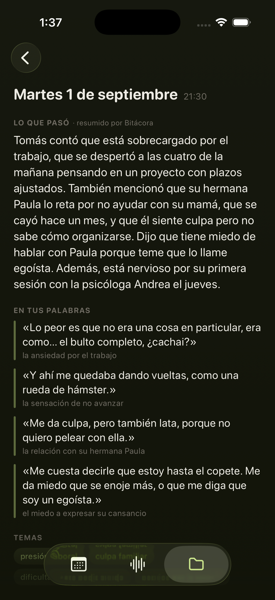

> Versión en español del README. La principal, en inglés, está en [README.md](README.md).

# Bitácora

**Un diario hablado para quien está en terapia.** Tocás la luz y hablás; Bitácora te
contesta con voz, recuerda lo que le contaste los días anteriores y, cada noche, deja
en el calendario un resumen del día y tus frases textuales para llevar a la próxima
sesión con tu psicólogo.



> Proyecto personal. Bitácora no es terapia ni la reemplaza, y no diagnostica.
> Todas las personas y conversaciones de las capturas son ficticias: salen de un mes
> simulado (`api/scripts/simular-mes.ts`).

## Qué hace

- **Charla por voz o por escrito**, con respuestas en streaming: el texto y la voz
  llegan mientras el modelo los genera.
- **La voz que entra no sale del teléfono**: se transcribe en el dispositivo (Speech
  de Apple sin red, `SpeechRecognizer` on-device en Android).
- **Memoria larga**: los resúmenes de cada día se guardan como vectores (pgvector) y
  en cada turno se recuperan y reordenan los que vienen al caso.
- **Para la terapia**: resumen del día, frases textuales con su tema, registro de cada
  sesión (qué entendiste, qué te aportó, cómo te sentiste) y un PDF para el psicólogo.
- **Calendario** con día lógico (corte a las 4 a. m.) y las consultas agendadas.
- **Corte de riesgo**: si un mensaje habla de autolesión, no se llama al modelo y se
  responde con un mensaje fijo y recursos de ayuda. Está duplicado en el teléfono y en
  el servidor.
- **Techo de gasto**: el servidor corta antes de llamar al proveedor si se pasa del
  presupuesto del mes, en dólares y en cantidad de llamadas.

| | | |
|---|---|---|
|  |  |  |

## Stack

| Parte | Tecnología |
|---|---|
| iOS | SwiftUI, SwiftData, Speech, AVFoundation (`ios/`) |
| Android | Kotlin, Jetpack Compose (`android/`) |
| Servidor | Node 22, TypeScript, Fastify, `pg` sin ORM (`api/`) |
| Base | PostgreSQL + pgvector (`db/`) |
| Modelos | Cualquier API compatible con OpenAI. En uso: DeepSeek V4 (charla y resúmenes), bge-m3 (embeddings), Qwen3-Reranker, TTS de Inworld; todo vía DeepInfra |

Cómo está armado y por qué: [docs/arquitectura.md](docs/arquitectura.md).

## Correrlo

```bash
brew install postgresql@17 pgvector
createdb bitacora && psql -d bitacora -f db/schema.sql
cd api && cp .env.example .env   # completar DATABASE_URL, AUTH_TOKEN y la clave del proveedor
npm install && npm start
```

Tests del servidor (usan una base aparte, `bitacora_test`):

```bash
createdb bitacora_test && psql -d bitacora_test -f db/schema.sql
cd api && npm test
```

**iOS:** abrir `ios/Bitacora.xcodeproj`. La dirección del servidor va en
`BITACORA_API_URL` (`ios/Bitacora-Info.plist`) y el token en
`ios/Bitacora/Servidor.plist`, que git ignora:

```bash
plutil -create xml1 ios/Bitacora/Servidor.plist && plutil -insert BITACORA_TOKEN -string "<tu AUTH_TOKEN>" ios/Bitacora/Servidor.plist
```

**Android:** abrir `android/` en Android Studio. La dirección y el token van en
`android/servidor.properties` (también ignorado):

```properties
url=http://10.0.2.2:3000
token=<tu AUTH_TOKEN>
```

## Licencia

[MIT](LICENSE).
