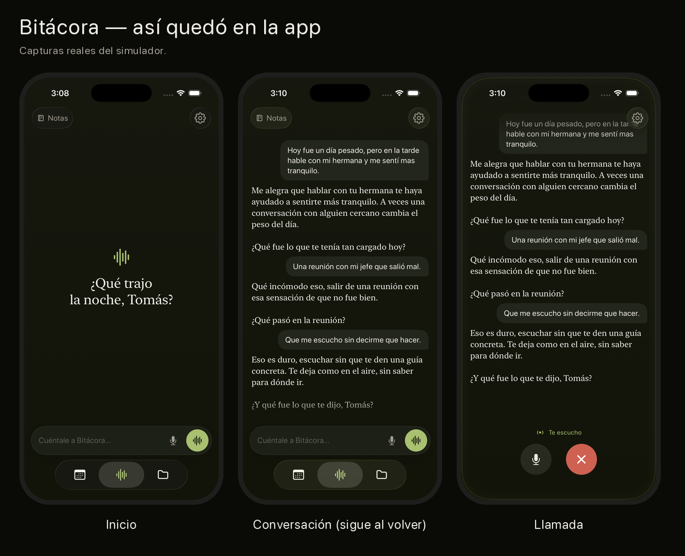
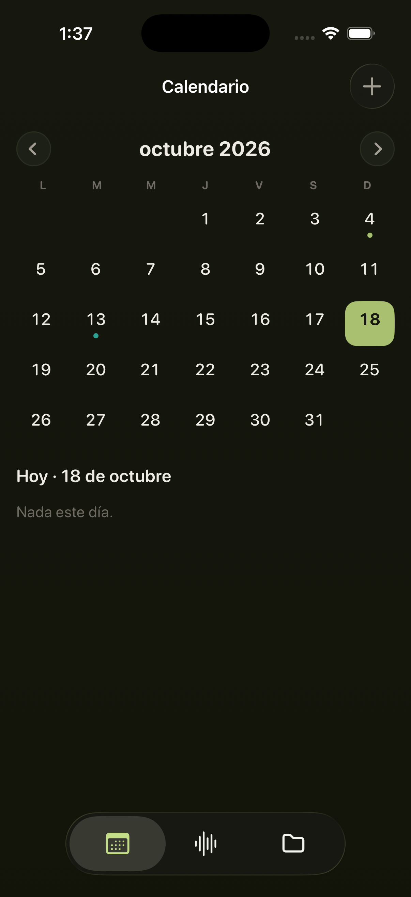
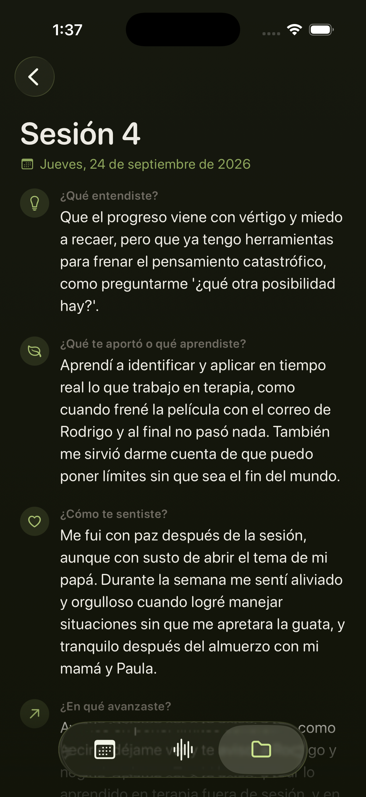
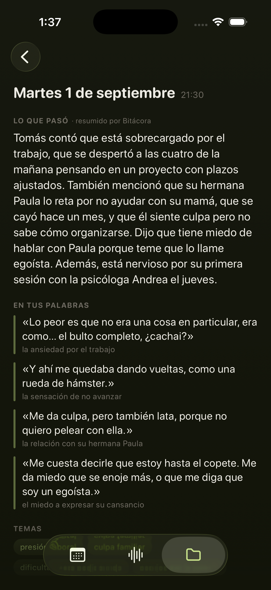

# Bitácora

> [Versión en español](README.es.md)

**A spoken journal for people in therapy.** Tap the light and talk; Bitácora
answers out loud, remembers what you told it on previous days, and every night
leaves a summary and your own literal phrases on the calendar — ready to take to
your next session.



> Personal project. Bitácora is not therapy, does not replace it, and does not
> diagnose. Every person and conversation in the screenshots is fictional, taken
> from a simulated month (`api/scripts/simular-mes.ts`).

## What it does

- **Talk or type**, with streamed responses: text and voice arrive while the model
  is still generating.
- **The voice never leaves the phone**: transcription happens on-device (Apple
  `Speech` offline, Android `SpeechRecognizer` on-device).
- **Long-term memory**: each day's summary is stored as a vector (pgvector), and
  every turn retrieves and reranks the ones that are actually relevant.
- **Built for the therapy session**: daily summary, literal quotes tagged by topic,
  a record of each session (what you understood, what helped, how you felt) and a
  PDF for the psychologist.
- **Calendar** with a logical day (cut-off at 4 a.m.) and scheduled appointments.
- **Risk cut-off**: if a message mentions self-harm, the model is never called —
  the app replies with a fixed message and help resources. Implemented twice, on
  the phone *and* on the server.
- **Spend ceiling**: the server stops before calling the provider once the monthly
  budget is exceeded, both in dollars and in number of calls.

| | | |
|---|---|---|
|  |  |  |

## Design decisions worth reading

- **The patient never sees the monthly report.** It goes to the psychologist. A
  patient reading their own clinical record tends toward self-diagnosis, which is
  the opposite of what the tool is for.
- **No data point without a quote.** Every item in the report is backed by a
  literal phrase from the patient. If there's no quote, the data point doesn't
  exist.
- **No diagnostic labels** anywhere in the generated language.
- **Risk detection is duplicated** on client and server, because a single point of
  failure on that path is not acceptable.

## Testing

**268 automated tests** — 151 backend, 96 iOS, 21 Android — plus a simulated month
of real usage to validate how the AI behaves over time rather than per message.

## Stack

| Layer | Technology |
|---|---|
| iOS | SwiftUI, SwiftData, Speech, AVFoundation (`ios/`) |
| Android | Kotlin, Jetpack Compose (`android/`) |
| Server | Node 22, TypeScript, Fastify, `pg` with no ORM (`api/`) |
| Database | PostgreSQL + pgvector (`db/`) |
| Models | Any OpenAI-compatible API. In use: DeepSeek V4 (chat and summaries), bge-m3 (embeddings), Qwen3-Reranker, Inworld TTS — all via DeepInfra |
| Infrastructure | Ubuntu VPS, systemd, Tailscale private network, one isolated instance per client |

How it is put together and why: [docs/arquitectura.md](docs/arquitectura.md).

## Running it

```bash
brew install postgresql@17 pgvector
createdb bitacora && psql -d bitacora -f db/schema.sql
cd api && cp .env.example .env   # fill in DATABASE_URL, AUTH_TOKEN and the provider key
npm install && npm start
```

Server tests (they use a separate database, `bitacora_test`):

```bash
createdb bitacora_test && psql -d bitacora_test -f db/schema.sql
cd api && npm test
```

**iOS:** open `ios/Bitacora.xcodeproj`. The server address goes in
`BITACORA_API_URL` (`ios/Bitacora-Info.plist`) and the token in
`ios/Bitacora/Servidor.plist`, which git ignores:

```bash
plutil -create xml1 ios/Bitacora/Servidor.plist && plutil -insert BITACORA_TOKEN -string "<your AUTH_TOKEN>" ios/Bitacora/Servidor.plist
```

**Android:** open `android/` in Android Studio. Address and token go in
`android/servidor.properties` (also ignored):

```properties
url=http://10.0.2.2:3000
token=<your AUTH_TOKEN>
```

## Licence

[MIT](LICENSE).
